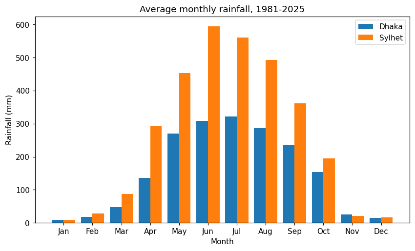
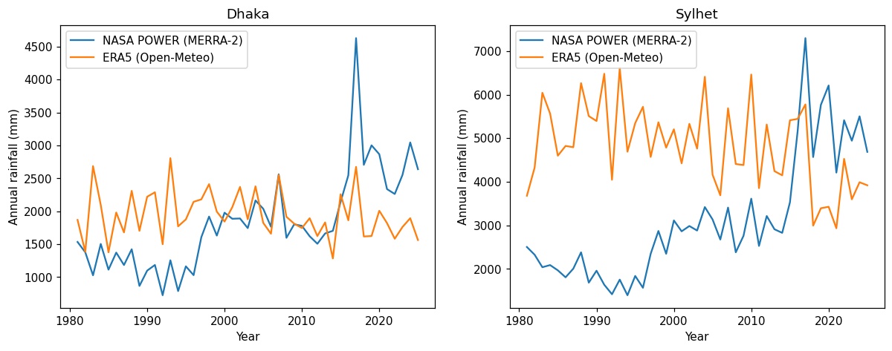

# Rainfall in Dhaka and Sylhet, 1981-2025: how consistent are gridded datasets?

A first data project in Python. I set out to measure rainfall trends in Dhaka and Sylhet, then found that two widely used gridded datasets disagree with each other.

## Questions
1. How much rain falls each month and year?
2. How much falls in the monsoon (June-September)?
3. Are heavy-rain days becoming more frequent?
4. Is annual rainfall trending up or down?
5. Do two independent datasets agree on the answers?

## Data
- **NASA POWER** (MERRA-2), daily `PRECTOTCORR`, mm/day, 1981-2025
- **ERA5** via the Open-Meteo archive API, daily precipitation sum, 1981-2025
- Locations: Dhaka (23.81 N, 90.41 E) and Sylhet (24.90 N, 91.87 E)
- Both are modelled, gridded products, not rain-gauge measurements

## Main results

**Seasonal pattern (NASA POWER)**
- Average annual rainfall: about 1,830 mm in Dhaka and about 3,110 mm in Sylhet
- The monsoon (June-September) brings about 63.5% of annual rain in Dhaka and 64.9% in Sylhet
- Dhaka's wettest month is July (about 322 mm); Sylhet's is June (about 595 mm)

**The two datasets disagree**
- Correlation of yearly totals between NASA POWER and ERA5: 0.13 for Dhaka, -0.32 for Sylhet
- The ratio NASA / ERA5 changes by decade (Sylhet: 0.43 in the 1980s, 1.40 in the 2020s), so at least one dataset has a bias that drifts over time
- Linear trend in annual rainfall:

| | NASA POWER | ERA5 |
|---|---|---|
| Dhaka | +417 mm/decade (p < 0.001) | -50 mm/decade (p = 0.23) |
| Sylhet | +862 mm/decade (p < 0.001) | -308 mm/decade (p = 0.004) |

## Conclusion
The seasonal pattern is consistent, but the long-term trend depends on which dataset is used, so neither dataset alone can show whether rainfall in these cities is really changing. The NASA POWER series shows a sharp rise after about 2015 that ERA5 does not show.

## Limitations
- Both datasets are model-based, with no ground observations to say which is closer to the truth
- Only two locations
- Straight-line trend tests assume a smooth change, which may not hold for a series with a step-like shift
- The heavy-rain day counts (50 mm or more) depend on how each dataset handles intensity, so treat them with caution

## Next steps
- Compare with rain-gauge records (for example BWDB or BMD) or a gauge-blended product such as CHIRPS
- Test the early period (1981-2014) separately

## Other figures
- `annual_rainfall.png`: yearly totals with 5-year averages
- `heavy_rain_days.png`: days with 50 mm or more per year
- `annual_max_rainfall.png`: wettest day of each year

## How to run
1. Open `rainfall_analysis.ipynb` in Google Colab.
2. Download daily `PRECTOTCORR` CSVs from NASA POWER for both locations, or use the files in this repo. In Colab, name them `dhaka.csv` and `sylhet.csv` (lowercase) and upload them to the Files panel.
3. In the Setup cell, set `DATA_DIR = Path("/content")`.
4. Run the cells in order. The ERA5 data downloads automatically.

## Tools
Python, Pandas, NumPy, Matplotlib, SciPy, Google Colab. I learned the Python basics from Tim Nelson's "Python for Water Resources" playlist.

*Author: Mohammed Shayan Tozeeh, 2nd-year EWCE student, MIST*
